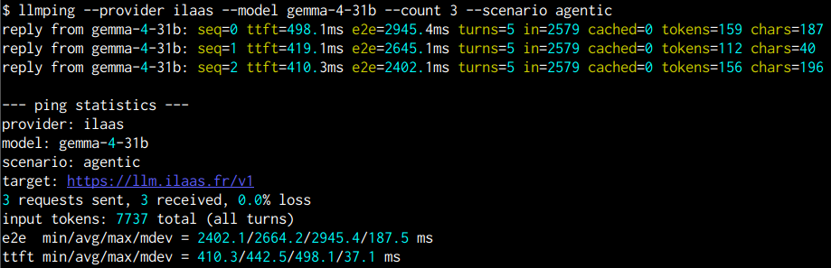

# llmping

`ping` for OpenAI-compatible LLM servers (vLLM, SGLang, TGI, llama.cpp,
Ollama, gateways): repeated minimal probes with ping-style live output,
loss %, latency stats, and exit codes that monitoring can act on.



Each round sends one request and prints a live line; a Ctrl-C-safe
statistics summary closes the run:

```
reply from mistral: seq=0 ttft=56.5ms e2e=1571.6ms turns=2 in=150 cached=62 tokens=21 chars=92
reply from mistral: seq=1 ttft=27.7ms e2e=1537.9ms turns=2 in=150 cached=62 tokens=21 chars=92
reply from mistral: seq=2 ttft=26.9ms e2e=1544.5ms turns=2 in=150 cached=62 tokens=21 chars=92

--- ping statistics ---
provider: mock
model: mistral
scenario: agentic-basic
target: http://127.0.0.1:8321/v1
3 requests sent, 3 received, 0.0% loss
input tokens: 450 total (186 cached) (all turns)
e2e  min/avg/max/mdev = 1537.9/1551.3/1571.6/13.5 ms
ttft min/avg/max/mdev = 26.9/37.1/56.5/13.0 ms
```

`in=`/`cached=` are the server's own token counts (`cached` = how much of
the prompt the server served from KV cache); `tokens=`/`chars=` are the
output side. The example above is an `agentic-basic` session (two model
turns per round) against the repo's mock server.

## What it measures

- **`pingpong`** (the default) — the plain probe: one turn, "please reply
  pong". TTFT/e2e/loss per round, ping(8)-style summary.
- **`agentic-basic`** — the model must call a `read_file` tool and answer
  a question about the file; the tool execution is **mocked** (llmping
  never touches a real filesystem — no side effects, no untrusted code
  runs).
- **`agentic`** — a full read → write → compile → run pipeline, every
  step mocked; the round is ok only if the answer passes the scenario's
  fact checks AND the pipeline actually succeeded.

Scenarios are defined in code (`src/llmping/scenario.py`), not YAML —
tool use needs executable mocking that config files can't express.
(The test suite is GPU-free for a separate reason: `tests/mockserver`
also plays the model's side deterministically, so no LLM server is
needed to test the whole loop.)
Assets: a run writes **nothing** to disk in its default form — the JSON
report goes to stdout (`--format json`); with `--dump-traffic`, raw wire
traffic lands in
`runs/<provider>_<model>_<scenario>_<ts>/traffic-<seq>.jsonl` (bodies both
raw and decoded, auth redacted, `/` in names escaped).

## Install

With [pipx](https://pipx.pypa.io) (recommended — isolated, on PATH):

```bash
pipx install git+https://github.com/lnussbaum/llmping
```

From a checkout (development):

```bash
git clone https://github.com/lnussbaum/llmping
cd llmping
python -m venv .venv
source .venv/bin/activate
pip install -e ".[dev]"
```

Requires Python ≥ 3.13. System `pip` is blocked on PEP 668-managed boxes —
use pipx or a venv (or `uv` if you have it).

## Configure

One file: **`providers.yaml`** — named endpoints + auth (gitignored;
tokens live here, never `.env`). There is **no `config.yaml`**: what to
ping is given on the command line. Copy `providers.example.yaml` and edit:

```yaml
# providers.yaml
providers:
  - name: local-vllm
    base_url: http://localhost:8000/v1
    token: ""                 # empty ⇒ Authorization header omitted
  - name: prod
    base_url: https://api.example.fr/v1
    token: s3cr3t
```

Providers discovery: `--providers PATH` → `$LLMPING_PROVIDERS` →
`./providers.yaml` → `~/.config/llmping/providers.yaml`
(`$XDG_CONFIG_HOME` honoured).

Connection details can also come from the environment when `providers.yaml`
leaves them out: per-provider `LLMPING_BASE_URL_<NAME>` /
`LLMPING_TOKEN_<NAME>` (name uppercased, non-alphanumeric → `_`) override the
global `LLMPING_BASE_URL` / `LLMPING_TOKEN`; an explicit YAML value always
wins. `$LLMPING_PROVIDER` is the default `--provider`. There are
**no `--base-url` / `--token` flags** — secrets never appear
on a command line (they would leak into shell history and `ps`).

## Usage

```bash
llmping --provider local-vllm --model gpt-oss-120b        # 1 round of the default pingpong scenario; exit 1 on any loss
llmping --provider local-vllm --model gpt-oss-120b --count 10 --interval 1.0
llmping --provider prod --model m1 --count inf           # until Ctrl-C (exit 130); one llmping per model
llmping --scenario                                        # list the valid scenario names, then exit
llmping --provider prod --model gpt-oss-120b --scenario agentic-basic   # forced read_file (mocked) → answer
llmping --provider prod --model deepseek-v4-flash-0731 --scenario agentic  # read→write→compile→run pipeline (mocked)
llmping --provider prod --model gpt-oss-120b --extra-body '{"reasoning_effort": "high"}'  # extra request body
llmping --provider prod --model gpt-oss-120b --pad 8000   # grow the prompt; server-counted input tokens are reported
llmping --provider prod --model gpt-oss-120b --nonce --pad 8000   # + bust the KV cache: true cold prefill each round
llmping --provider prod --list-models                    # query mode: list the provider's advertised models, then exit
```

`--provider NAME` picks the provider; it's optional — without it the run
uses `$LLMPING_PROVIDER`, else the provider named `default` in
providers.yaml. One run pings **exactly one model** (`--model MODEL`);
repeating `--model` is a usage error — run one llmping per model.

Run flags: `--providers`, `--runs-dir`, `--dump-traffic` (log
every HTTP exchange — raw + decoded — to
`<runs-dir>/<provider>_<model>_<scenario>_<ts>/traffic-<seq>.jsonl`),
`--pad N` (N chars of inert padding appended to the first user message —
grows the prompt to exercise token accounting; input tokens are reported),
`--nonce` (prepends a random per-round nonce to the first message — busts
the server's KV/prefix cache so every round pays a true cold prefill; the
server-reported cached token count shows up as `cached=`),
`--format table|json` (JSON prints the report on stdout, status on stderr).

The JSON report carries `provider`, `model`, `scenario`, `base_url`,
`providers_path`, `duration_s`, `timestamp` (run start, ISO-8601 UTC) and
`stats` — sent/replies/loss_pct, e2e/ttft min-avg-max-mdev, tokens,
input_tokens, cached_tokens, chars, turns — flat, not keyed by model.

The CLI is one command — no subcommand.
Short options: `-p` provider, `-m` model, `-s` scenario, `-c` count,
`-i` interval, `-t` timeout, `-d` dump-traffic, `-f` format, `-l`
list-models, `-V` version, `-h` help (values attach too: `-mmistral`,
`-fjson`).

Exit codes: `0` ok · `1` degraded (ping loss, or a failed `--list-models` request) ·
`2` config/usage error · `130` interrupted `--count inf`.

## Recurring monitoring

`scripts/llmping-run.py` (see [scripts/README.md](scripts/README.md))
schedules llmping across a target list on cron and renders the collected
history into a static HTML dashboard (status cards, per-target uPlot
charts, comparison pages for targets sharing a `group:`, time-window
chips). History is append-only JSONL; the site is self-contained and
needs no server.

```bash
python scripts/llmping-run.py probe --report    # probe all targets, regenerate site/
```

## Development

```bash
pip install -e ".[dev]"     # in the venv from Install
pytest                      # tests run against the repo's mock server (tests/mockserver)
```

Quality gate — all four must pass before committing:
`ruff check`, `ruff format --check`, `mypy src`, `pytest`.
Coverage is informational: `pytest --cov=llmping --cov-report=term-missing`.

Tests need no GPU: they run against the deterministic mock server
(`tests/mockserver`). Run it standalone as a loopback target:

```bash
python -m tests.mockserver.serve --port 8321
```

Tune it with `LLMPING_MOCK_FIRST_CHUNK_MS`, `LLMPING_MOCK_CHUNK_MS`, and the
comma-separated model-name presets `LLMPING_MOCK_FAIL` (503),
`LLMPING_MOCK_THINK_ONLY` (reasoning, no visible answer),
`LLMPING_MOCK_SERIAL` (one file read per tool turn),
`LLMPING_MOCK_EMPTY` (HTTP 200 with no content and no reasoning) and
`LLMPING_MOCK_WRONG_ANSWER` (plausible text that fails the scenario's checks).

## License

MIT — see [LICENSE](LICENSE).
